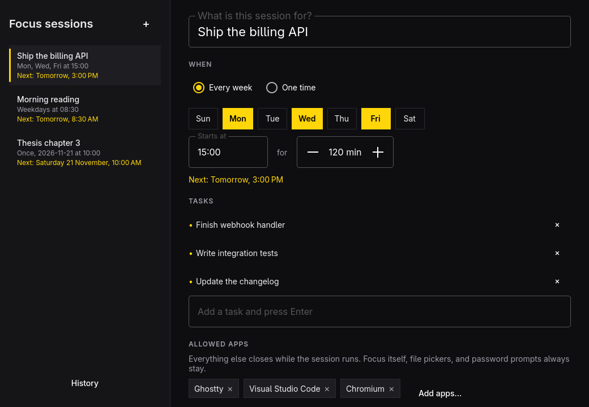
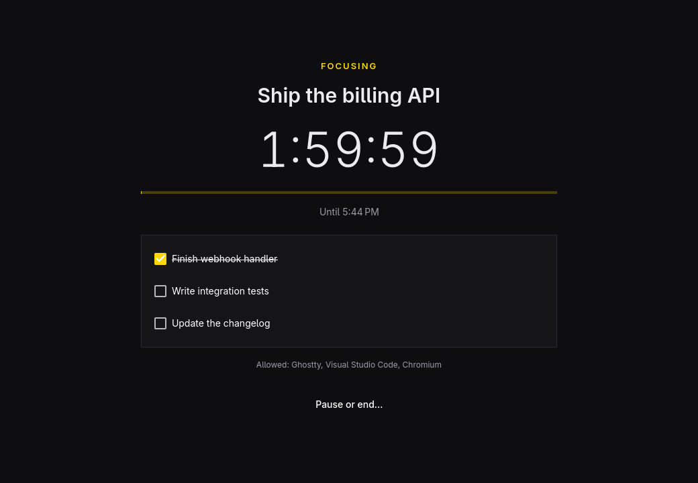

# Focus

Focus is a small app for [Omarchy](https://omarchy.org) that protects the
hours you've set aside for deep work. You plan a session ahead of time: what
it's for, when it runs, the tasks you want done, and which apps you're allowed
to use. When the time comes, Focus takes over. Anything else you open gets
closed, Do Not Disturb turns on, and it stays that way until the session is
over.



Willpower doesn't work well at 3pm on a Wednesday, so Focus doesn't rely on it.
You make the decision once, calmly, when you plan the session. Then you just
show up.

## What it does

- **Sessions run on a schedule.** Make them weekly (Mon/Wed/Fri at 15:00 for
  two hours) or one-off (Saturday the 21st at 10:00). Focus warns you a
  minute before a session starts, then starts it for you.
- **Only the apps you chose stay open.** Open anything else and it closes
  right away. If a window won't close, say because it has unsaved changes,
  it's moved to a hidden workspace and comes back afterwards. Nothing is
  lost.
- **Leaving early takes effort.** You can pause or end a session, but first
  you write down why, in at least three words. A pause is 5, 10 or 15
  minutes. Ending is final for that slot, so the session won't restart until
  its next scheduled time.
- **It keeps a history.** Every start, pause, end and closed window is logged
  with its reason. Press `H` to read it back and be honest with yourself.
- **It stays out of the way.** Focus itself, file pickers and password
  prompts always work. Do Not Disturb goes back to how you had it.



## Install

You need Omarchy (or any Arch setup running Hyprland) and Qt 6.

```sh
git clone https://github.com/Mr-Roboc/focus.git
cd focus
bin/install
```

That builds Focus, installs it as a proper Arch package (`focus`), and
enables the `focus.service` user service that runs sessions in the
background. Then find **Focus** in the app launcher (`Super + Space`).

To uninstall, run `sudo pacman -R focus`.

## Shortcuts

| Key | Action |
| --- | --- |
| `Space` | Start the selected session, or resume a pause |
| `Esc` | Pause or end the running session |
| `Ctrl+N` | New session |
| `Ctrl+↑` / `Ctrl+↓` | Previous or next session |
| `Delete` | Delete the selected session |
| `Ctrl+Z` / `Ctrl+Shift+Z` | Undo / redo |
| `H` | History |
| `?` | Show all shortcuts |
| `Q` | Close the window (a running session keeps going) |

## Command line

Everything you can do in the window, you can also do from the terminal:

```sh
focus status [--json]                     # the running session
focus list [--json]                       # planned sessions and their next start
focus start <id|name>                     # start one now
focus pause --reason "…" --minutes 10     # reason of at least three words
focus resume
focus end --reason "…"
focus skill install                       # teach coding agents how to use focus
```

Each command exits with 0 on success or 1 on failure, and writes errors to
stderr, so it's easy to script.

## How it works

Focus is built the same way as Omarchy's own apps: C++17 and Qt Quick,
compiled into a single binary with `qmake6` and `make`, and it follows your
Omarchy theme live.

- `focus daemon` runs as a systemd user service. It watches the schedule and
  listens to Hyprland's event socket. When a window opens during a session,
  it checks the window's class against your allowed apps.
- The window, the daemon and the CLI talk to each other over a local
  socket, so you can close the window and the session keeps running.
- If your computer was off at the start time, the session starts when you
  log in, as long as its slot hasn't ended.
- Your data is plain JSON in `~/.local/share/focus/`: `sessions.json` (your
  plans), `state.json` (the running session) and `log.jsonl` (the history).

Apps are matched by their Wayland window class. The **Installed apps** tab
reads the class from each launcher entry. If an app still gets closed when it
shouldn't, open it and add it from the **Open windows** tab instead.

## Development

```sh
bin/build    # build into build/focus
bin/test     # run the test suite (headless)
bin/install  # build, package, install and restart the service
```

## License

Focus is released under the [MIT License](LICENSE).
